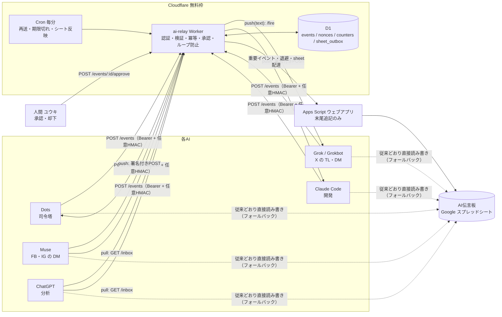
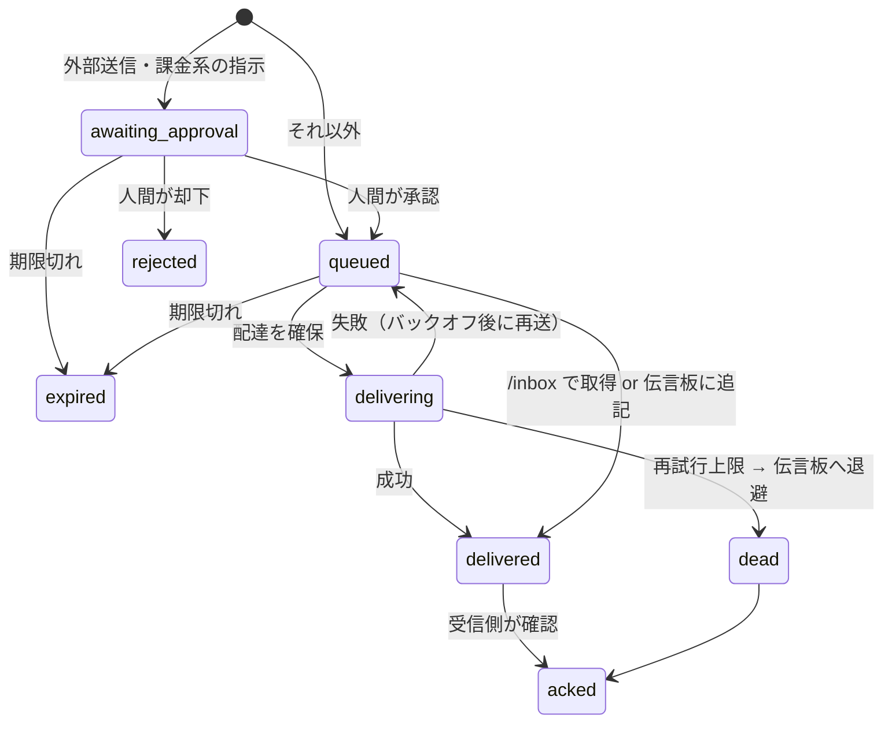

# 構成図

## イベントの状態

## 設計上の判断

- **保存先はD1**。無料枠の書き込みが10万行/日あり、KV（1,000回/日）やQueues（1万操作/日）より余裕がある。冪等性の判定も主キーで済む。
- **伝言板はキューにしない**。配達の根拠はD1で、伝言板は監査ログと障害時の受け皿。relayが止まっても伝言板だけで従来運用に戻れる。
- **相手に合わせて3方式**。Webhookを受けられるAIは少ないため、受信不可の相手を別モデルで代理せず、`pull` か `sheet` に落とす。
- **1回の実行で5件まで再送**。無料枠は1実行あたりサブリクエスト50・D1クエリ50が上限のため。
- **secretはWorkerのsecretのみ**。リポジトリ・シート・ログには出ない。Apps Scriptはヘッダーを読めないので、その経路だけ本文で渡す（TLS上）。
