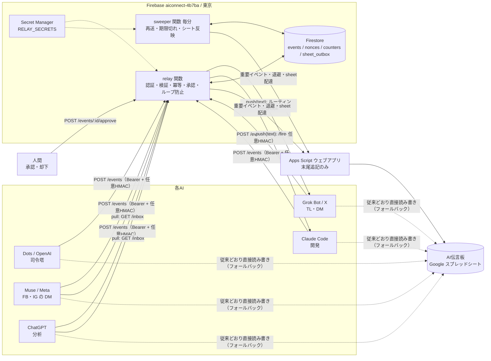
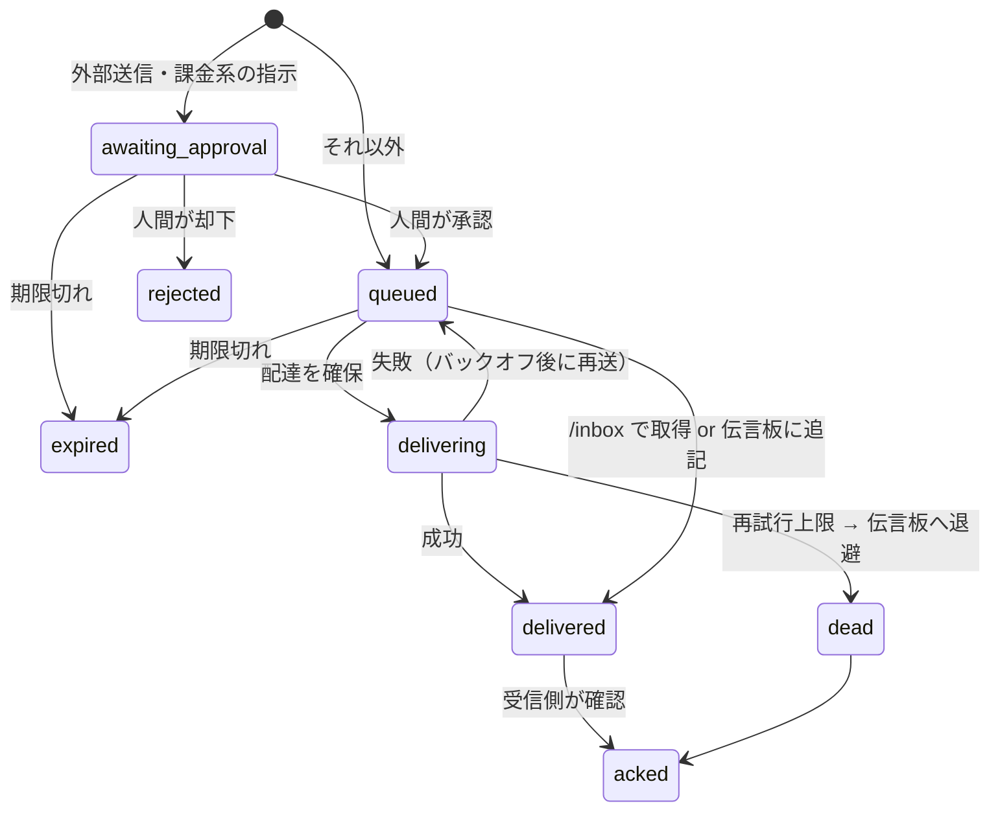

# 構成図

## イベントの状態

## 設計上の判断

- **保存先はFirestore**。状態の変更はすべてトランザクションで行い、同じイベントを二重に配達しない。クライアントSDKからの読み書きはルールで全面拒否し、関数（Admin SDK）だけが触る。
- **秘密情報は1つのシークレットにまとめる**。Secret Managerの無料枠は有効バージョン6個までなので、トークン類をJSON1個（`RELAY_SECRETS`）に入れている。
- **応答前に最初の配達を済ませる**。Cloud Functionsは応答後にCPUが止まりうるため、`POST /events` は初回の配達試行が終わってから返す（相手が遅いと最大10秒）。
- **伝言板はキューにしない**。配達の根拠はFirestoreで、伝言板は監査ログと障害時の受け皿。relayが止まっても伝言板だけで従来運用に戻れる。
- **相手に合わせて3方式**。受信口のないAIを別モデルで代理せず、`pull` か `sheet` に落とす。
- **暴走対策**。`maxInstances: 2`、1日の受理上限、ホップ数上限、ペイロード16KB上限。Blazeプランには上限保証がないため、関数側で絞っている。
